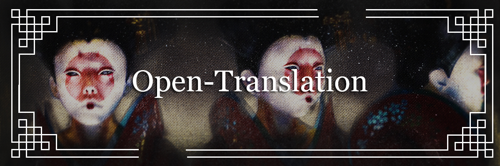

# Open-Translation



Manga-page translation. OCR finds the text bubbles, a language model cleans and translates them, and you get either a composited image or JSON with relative coordinates (`x`, `y`, `w`, `h` as ratios of the page) so you can render the translation at any scale.

## Requirements

- Python 3.10
- [Tesseract](https://github.com/tesseract-ocr/tessdata_best) with the language packs you need (`jpn_vert` for vertical Japanese)
- A [Groq](https://console.groq.com/) API key for translation

```bash
cp .env.example .env
# put GROQ_API_KEY in .env — never commit that file
pip install -r requirements.txt
```

On Windows only, if `tesseract` is not on your `PATH`:

```bash
# in .env
TESSERACT_CMD=C:/Program Files/Tesseract-OCR/tesseract.exe
```

Install a language pack:

```bash
# Linux
sudo apt-get install tesseract-ocr-jpn tesseract-ocr-jpn-vert

# macOS
brew install tesseract-lang

# Windows — from the tessdata folder
curl -LO https://github.com/tesseract-ocr/tessdata_best/raw/main/jpn_vert.traineddata
```

## Docker

```bash
export GROQ_API_KEY=your_key
docker compose up --build
```

API listens on `http://localhost:8080`. Health check: `GET /health`.

## CLI

```text
usage: trad.py [-h] [-i INPUT_LANGUAGE] [-o OUTPUT_LANGUAGE] [-if INPUT_FOLDER]
               [-of OUTPUT_FOLDER] [-t TRANSPARENCY] [-j JSON]
```

```bash
python trad.py -i jpn_vert -if ./original -of ./translated
```

JSON fields per bubble:

| field | meaning |
| --- | --- |
| `x`, `y`, `w`, `h` | position and size as a ratio of the page |
| `original_text_<lang>` | OCR output |
| `text_<lang>` | translation |

## API

`POST /translate` with an image upload and an `Authorization: Bearer <key>` header (`demo_key` for local tests). See `main.py`.
